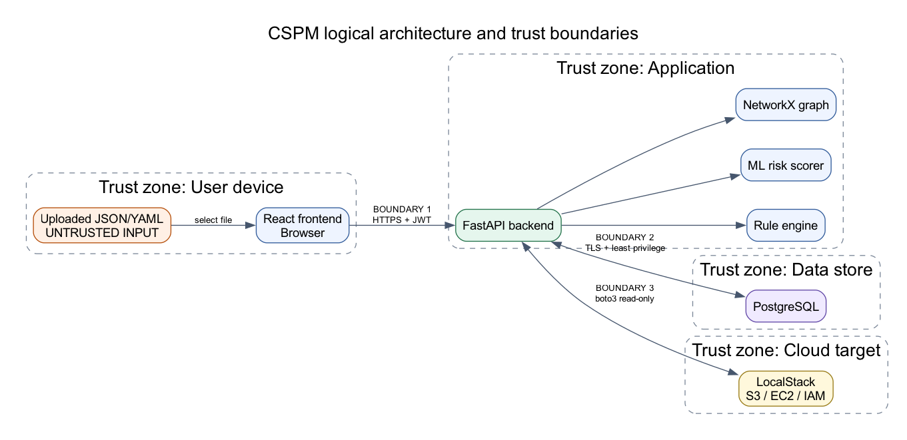

# AI-Powered Cloud Security Posture Management

A full-stack cybersecurity platform for analyzing uploaded cloud configurations and emulated live AWS environments. It combines a benchmark-mapped declarative rule engine, ML-based risk prioritization and anomaly detection, CIS/NIST compliance reporting, and graph-based attack-path visualization, behind a multi-user, role-based authentication layer.

**Current status:** Phases 0–8 are implemented — secure parsing and rule engine, the FastAPI/Postgres backend, the React dashboard, live LocalStack-cloud scanning, ML risk scoring, attack-path analysis, CIS/NIST compliance mapping, and Argon2id/JWT authentication with Admin/Viewer RBAC and audit logging. Phase 9 (CI/CD hardening + self-scanning) and Phase 10 (deployment) are next; see [the execution plan](guides/Phases%20%284-11%29%20Execution%20Plan.md) for the detailed wave-by-wave breakdown.

## Architecture



The React dashboard authenticates via httpOnly JWT cookies and talks to FastAPI, which orchestrates the rule engine, the XGBoost/Isolation Forest scorer, and the NetworkX attack-path graph. PostgreSQL stores application state (users, scans, findings, audit log); boto3 connects the API to LocalStack for live cloud scanning. Uploaded JSON/YAML and live-collected resources are both treated as untrusted input.

See [the schema](docs/schema.md), [the threat model](docs/threat-model.md), the [OWASP ASVS L1 checklist](docs/asvs-l1-checklist.md), and [the full project plan](guides/Major%20Project%20Planning.md).

## Technology stack

- React, Tailwind CSS, TanStack Query, React Force Graph
- Python 3.11, FastAPI, and Pydantic
- PostgreSQL with SQLModel/SQLAlchemy and Alembic
- boto3 and LocalStack
- NetworkX, scikit-learn, and XGBoost
- Argon2id (`pwdlib`), PyJWT, and `slowapi` rate limiting
- Docker Compose and GitHub Actions

## Prerequisites

- Git
- Docker Desktop with Docker Compose v2
- Python 3.11 for backend development
- Node.js LTS for frontend development

Docker is the easiest runtime for the full backend stack because it starts PostgreSQL, LocalStack, runs database migrations, and serves FastAPI. Python is needed for local backend tests, and Node.js for the frontend. Use Python 3.11 for full backend dependency installation; newer unreleased/interpreter-edge versions may not have wheels for all pinned packages.

## Run the backend stack

```bash
git clone <repository-url>
cd cloud-security-posture-management
cp .env.example .env
```

Before continuing, open `.env` and set `JWT_SECRET` to a real random value (32+ characters — the app refuses to run authentication on the placeholder) and `ADMIN_EMAIL` to the address you'll sign up with first. Every other signup becomes a Viewer; only the address matching `ADMIN_EMAIL` becomes Admin, and only Admins can upload a scan or trigger a live cloud scan.

```bash
cd infra
docker compose up --build -d
```

Compose waits for PostgreSQL and LocalStack to become healthy before starting the API. Check all services:

```bash
docker compose ps
curl --fail http://localhost:8000/health
```

The API response should be:

```json
{"status":"ok"}
```

Verify PostgreSQL and LocalStack:

```bash
docker compose exec postgres pg_isready -U postgres -d cspm
docker compose run --rm backend python /scripts/test_s3.py
```

The backend container runs `alembic upgrade head` before starting FastAPI, so the database tables and seeded compliance map are created automatically. The LocalStack smoke test creates `cspm-phase-zero-smoke-test` and confirms it can be listed. Local services are exposed at:

| Service | Address |
| --- | --- |
| FastAPI health endpoint | <http://localhost:8000/health> |
| FastAPI OpenAPI UI | <http://localhost:8000/docs> |
| PostgreSQL | `localhost:5432` |
| LocalStack gateway | <http://localhost:4566> |

Stop the environment without deleting its named volumes:

```bash
docker compose down
```

## Run the frontend

```bash
cd frontend
cp .env.example .env
npm install
npm run dev
```

Opens at <http://localhost:5173>. `.env`'s `VITE_USE_MOCKS=true` runs the dashboard standalone against MSW-mocked data (no backend needed) — useful for frontend-only work. Set `VITE_USE_MOCKS=false` to talk to the real backend started above; sign up (the first account, matching `ADMIN_EMAIL`, becomes Admin) and upload a config or run a live cloud scan to see real findings, risk scores, attack paths, and compliance status end to end.

## Run tests

Backend (pytest; set a real `JWT_SECRET` first, same rule as above):

```bash
python3.11 -m venv .venv
.venv/bin/python -m pip install -r backend/requirements-dev.txt
./scripts/run_tests.sh
```

This covers the secure parser and rule engine, scan/compliance/attack-path API endpoints, the cloud connector, ML scoring, authentication (signup/login/JWT/CSRF), RBAC and audit logging, and attacker-perspective security tests (forged JWTs, rate-limit abuse, CORS misconfiguration) — see [the ASVS L1 checklist](docs/asvs-l1-checklist.md) for how these map to concrete security controls.

Frontend (Vitest):

```bash
cd frontend
npm install
npm test
```

To verify migrations without Docker:

```bash
cd backend
DATABASE_URL=sqlite:///./local_migrations.db alembic upgrade head
rm local_migrations.db
```

## Repository structure

```text
backend/   FastAPI application — rule engine, cloud connector, ML scoring,
           attack-path graph, compliance engine, authentication/RBAC
frontend/  React dashboard (upload, scans, findings, attack paths, compliance, auth)
ml/        Simulated-data pipeline and trained XGBoost / Isolation Forest models
infra/     Local Docker Compose environment
rules/     Declarative security rules
docs/      Architecture, schema, threat model, and the ASVS L1 checklist
scripts/   Development smoke-test utilities
guides/    Project plan and the wave-by-wave execution plans
```

## Security

Never commit `.env`, cloud credentials, database passwords, model artifacts, or tokens. Copy `.env.example` locally and replace its development-only placeholders — in particular, rotate `JWT_SECRET` and set `ADMIN_EMAIL` before relying on authentication. Report vulnerabilities according to [SECURITY.md](SECURITY.md).

GitHub repository settings should require pull requests and one approval on `main`, enable Dependabot alerts and security updates, enable secret scanning and push protection, and enable private vulnerability reporting. The checked-in Dependabot and gitleaks configurations provide weekly dependency updates and secret scanning on pull requests and pushes to `main`.
